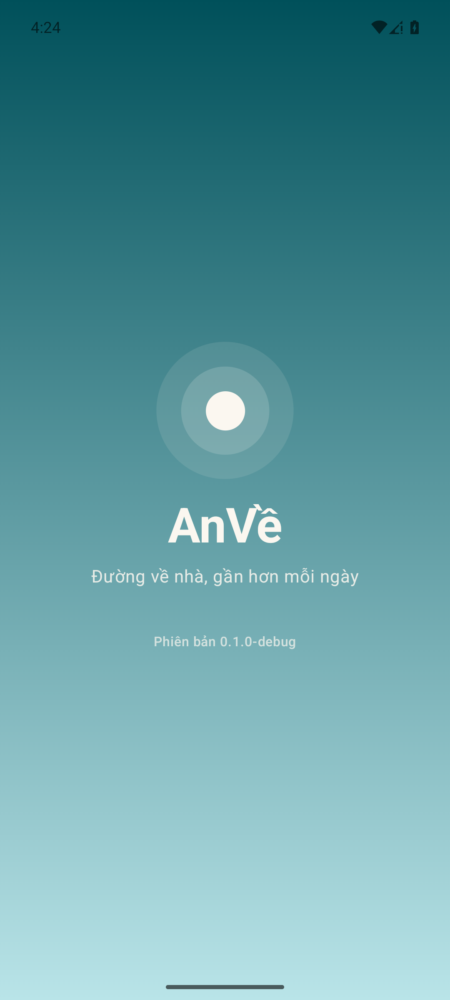
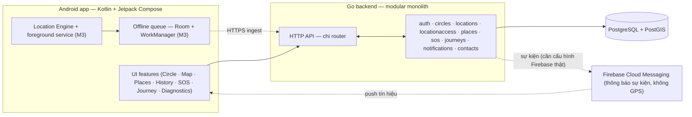

# AnVề

[](https://github.com/QuocDuong16/anve/actions/workflows/go.yml)
[](https://github.com/QuocDuong16/anve/actions/workflows/android.yml)

> **Đường về nhà, gần hơn mỗi ngày.**

**AnVề** là ứng dụng Android chia sẻ vị trí và hỗ trợ an toàn cho các thành viên
trong gia đình: mỗi người chủ động chia sẻ vị trí của mình, cả nhà biết nhau
đang ở đâu, vị trí được cập nhật lần cuối khi nào, dữ liệu đó đáng tin ở mức
nào, và có cần hỗ trợ hay không.

Điểm khác biệt cốt lõi của AnVề: ứng dụng không chỉ vẽ một marker trên bản đồ —
nó cho người xem biết **dữ liệu vị trí mới đến đâu và đáng tin ở mức nào**
(Location Confidence), trong khi quyền chia sẻ luôn nằm trong tay từng thành
viên và được backend thực thi (Privacy & Consent), với Location Engine tiết kiệm
pin và bám sát thực tế Android (Battery-Aware, Android Reliability).

AnVề **không phải spyware**: không có chế độ theo dõi bí mật, không giám sát ai
mà không có sự đồng ý của họ. Ứng dụng cũng không thay thế dịch vụ cấp cứu
chuyên nghiệp.

- **Dành cho:** gia đình nhỏ — phụ huynh dõi con đi học/về muộn, con cái dõi bố
  mẹ ở xa, các cặp vợ chồng đi làm về muộn.
- **Định vị:** *Family Safety & Location Intelligence for Android.*
- **Phạm vi ban đầu:** gia đình nhỏ; kiến trúc đủ tốt để mở rộng hoặc thương mại
  hóa trong tương lai.

## Trạng thái phát triển

Dự án đã triển khai ở mức mã nguồn + kiểm thử tự động các mốc **M0 (foundation)**,
**M1 (authentication, thiết bị, privacy foundation)**, **M2 (Family Circle, avatar, lời mời email)**,
**M3 (Location Engine, consented ingestion, offline sync)**, **M4 (authorized Live Map & freshness)**,
**M5 (Location History & Place Alerts)**, **M6 (SOS & notifications qua fake provider)**,
**M7-A/M7-B (Diagnostics & Safe Journey)** và nền tảng **M8-A..M8-D (observability, Android release/privacy gates, landing page & `/privacy`, `/delete-account` trên server)**.

Mức xác minh hiện tại là **code + automated verification** (PostgreSQL/PostGIS integration tests,
Go/Android unit tests, lint/APK/release-config checks và emulator CI). Các phần
**vẫn đang chờ kiểm chứng bên ngoài**: Google Sign-In/Maps/FCM với project thật,
chạy thực địa trên điện thoại Android vật lý (pin, nền, reboot, OEM, GPS),
và deploy domain HTTPS công khai. Trạng thái chi tiết từng mốc và bằng chứng xác minh ở
[`docs/product/roadmap.md`](docs/product/roadmap.md) và
[`docs/implementation/progress.md`](docs/implementation/progress.md).



## Phạm vi chức năng

Tổng quan các nhóm tính năng. Đặc tả đầy đủ và ranh giới xác minh từng nhóm ở
[`docs/product/features.md`](docs/product/features.md).

| Nhóm chức năng | Mô tả | Trạng thái |
| --- | --- | --- |
| Nền tảng M0 | Splash screen, health/meta API, migrations, CI, toolchain | **Implemented — Verified** |
| Xác thực & phiên | Google/dev login, session opaque có rotation, thiết bị, xóa tài khoản | **Implemented — Verified** (M1; chờ OAuth client thật & thiết bị thật) |
| Family Circle | Nhóm gia đình, link/mã mời, lời mời ràng buộc email, avatar, ủy quyền | **Implemented — Verified** (M2 + profile/email) |
| Live Map | Bản đồ thành viên được cấp quyền, cập nhật qua polling có điều kiện | **Implemented — Automated Verified** (M4); chờ Maps API key & thiết bị thật |
| Smart Tracking | Location Engine thích ứng, tiết kiệm pin, chạy nền đúng quy trình | **Implemented — Automated Verified** (M3); Pending Field Validation |
| Location Confidence | Trạng thái Fresh/Delayed/Stale/Unknown theo thời điểm ghi nhận và độ chính xác | **Implemented — Automated Verified** (M4); Pending Runtime/Device Validation |
| Location History | Hành trình theo ngày, xóa lịch sử/fences, giữ mặc định 30 ngày | **Implemented — Automated Verified** (M5-A); Pending Device Validation |
| Offline Sync | Room durable queue, batch, idempotency, preserve timestamps | **Implemented — Automated Verified** (M3); Pending Field Validation |
| Privacy Controls | Consent mặc định tắt, thu hồi quyền theo viewer, audit bất biến | **Implemented — Automated Verified** (M1–M5) |
| Place Alerts | Địa điểm an toàn & đánh giá đến/rời từ mẫu vị trí đã đồng bộ | **Implemented — Automated Verified & Emulator Verified** (M5-B); Pending Device Validation |
| SOS & Emergency | Sự kiện khẩn cấp (không đính kèm tọa độ), người nhận, xác nhận | **Implemented — Automated Verified** (M6 với fake provider); chờ FCM & thiết bị thật |
| Safe Journey | Hành trình về nhà có thời hạn, ước tính đến nơi tùy chọn & nhắc thiếu cập nhật | **Implemented — Automated Verified** (M7-B); Pending Field Validation |
| Tracking Health | Chẩn đoán quyền/pin/mạng/hàng đợi & xuất báo cáo không tọa độ | **Implemented — Automated Verified** (M7-A); Pending Field Validation |
| Notifications | FCM mang ID/loại sự kiện (không truyền GPS) | **Implemented — Automated Verified** (M6 với fake provider); chờ Firebase thật |
| Trang web công khai | Trang giới thiệu `/`, form liên hệ, `/privacy` và `/delete-account` | **Implemented — Server Verified**; chờ deploy domain HTTPS công khai |

Quy ước trạng thái (Implemented / Verified / Planned / Proposed / Not in scope)
định nghĩa ở [`docs/product/overview.md`](docs/product/overview.md#7-phân-loại-trạng-thái-status-taxonomy).

## Kiến trúc

Android client (Kotlin + Jetpack Compose + Maps Compose) giao tiếp qua HTTPS
với backend Go (modular monolith, chi router), dữ liệu lưu trong
PostgreSQL/PostGIS. Live Map lấy snapshot được phân quyền bằng conditional
polling; FCM chỉ dùng cho thông báo sự kiện (không truyền GPS) — xem
[`docs/architecture/overview.md`](docs/architecture/overview.md) để biết ranh giới
component, data flows và các quyết định còn mở.



## Công nghệ

| Tầng | Công nghệ |
| --- | --- |
| Android | Kotlin, Jetpack Compose, Maps Compose, Fused Location Provider, Room, WorkManager, Firebase Cloud Messaging, Play App Update |
| Backend | Go 1.27.4, chi router, pgx, PostgreSQL + PostGIS (location ingestion, retention & event evaluation) |
| Contracts & Privacy | OpenAPI (`packages/api-contracts/openapi.yaml` — đổi contract trước handler), Android privacy baseline (`packages/privacy/`) |
| Hạ tầng dev & prod | Docker Compose (postgres/postgis + migrate + api + Caddy HTTP origin), GitHub Actions, mise |

*Lưu ý: Maps Compose và Firebase Messaging SDK đã được tích hợp trong dự án (Place Alerts đánh giá từ mẫu vị trí đã đồng bộ phía server, không dùng OS Geofencing API); việc render bản đồ và push thật cần API key / cấu hình Firebase ngoài repository theo `docs/implementation/setup-android.md` và `docs/operations/first-real-test.vi.md`.*

### Development stack & development login

`make docker-up-dev` chỉ publish cổng API và PostgreSQL trên `127.0.0.1`; máy
khác trong LAN không truy cập được. `make docker-up` dành cho production, đọc
`.env.prod`, chạy migrations và expose HTTP origin qua Caddy (`/`, `/privacy`,
`/delete-account`, `/assets/*`, `/api/*`, `/healthz`, `/readyz`) cho Cloudflare
Tunnel. HTTPS public do Cloudflare xử lý. Xem
[`docs/operations/first-real-test.vi.md`](docs/operations/first-real-test.vi.md)
để chuẩn bị DNS, OAuth và máy chủ. Chạy API trực tiếp (không Docker) mặc định bind
`127.0.0.1:8080`. Development login chỉ mount khi
`ENVIRONMENT=development` và `AUTH_DEV_LOGIN_ENABLED=true`, và còn phải qua
allowlist địa chỉ nguồn; xem
[`docs/implementation/setup-android.md`](docs/implementation/setup-android.md).
`make compose-lint` (chạy trong `make quality-check` và CI) fail nếu một port
Compose bị publish ra ngoài loopback.

## Roadmap

| Milestone | Phạm vi | Trạng thái |
| --- | --- | --- |
| M0 | Foundation: toolchain, CI, migrations, local stack, splash | **Implemented — Verified** |
| M1 | Authentication, device identity, privacy foundation | **Implemented — Verified** (automated; chờ OAuth thật & field validation) |
| M2 | Family Circle, avatar, email/link invites & membership authorization | **Implemented — Verified** (automated; chờ field validation) |
| M3 | Location Engine, Smart Tracking, offline queue, consented ingestion | **Implemented — Automated Verified** (runtime HTTP smoke; Pending Field Validation) |
| M4 | Live Map, authorized latest locations, confidence engine | **Implemented — Automated Verified**; Pending Runtime/Device Validation |
| M5 | Location History & Place Alerts | **Implemented — Automated Verified**; Pending Device Validation |
| M6 | SOS, Firebase push, event acknowledgement | **Implemented — Automated Verified** (fake provider); chờ Firebase thật & thiết bị |
| M7 | Safe Journey, diagnostics, field validation | **M7-A & M7-B Automated Verified**; field validation trên thiết bị thật còn mở |
| M8 | Release hardening, observability, Google Play readiness | **M8-A/B/C/D Implemented**; public HTTPS URLs, provider & device gates còn mở |

Chi tiết exit criteria và bằng chứng xác minh của từng mốc:
[`docs/product/roadmap.md`](docs/product/roadmap.md).

## Tài liệu

| Tài liệu | Nội dung |
| --- | --- |
| [`docs/product/overview.md`](docs/product/overview.md) | Tầm nhìn, đối tượng, điểm khác biệt, goals/non-goals |
| [`docs/product/features.md`](docs/product/features.md) | Đặc tả chức năng đầy đủ + trạng thái từng nhóm |
| [`docs/product/user-journeys.md`](docs/product/user-journeys.md) | Hành trình người dùng end-to-end |
| [`docs/product/privacy-and-safety.md`](docs/product/privacy-and-safety.md) | Consent, authorization, retention, chống lạm dụng |
| [`docs/product/roadmap.md`](docs/product/roadmap.md) | Milestones và trạng thái đã xác minh |
| [`docs/product/glossary.md`](docs/product/glossary.md) | Thuật ngữ dùng chung |
| [`docs/product/non-functional-requirements.md`](docs/product/non-functional-requirements.md) | Quality attributes, cách đo, proposed targets |
| [`docs/architecture/overview.md`](docs/architecture/overview.md) | Kiến trúc, data flows, trust boundaries |
| [`docs/implementation/progress.md`](docs/implementation/progress.md) | Tiến độ chi tiết & bằng chứng kiểm thử từng giai đoạn |
| [`docs/operations/first-real-test.vi.md`](docs/operations/first-real-test.vi.md) | Hướng dẫn chuẩn bị hạ tầng thật, OAuth/Firebase & test |
| [`docs/operations/android-release.md`](docs/operations/android-release.md) | Quy trình ký, verify AAB & release Android |
| [`docs/release/m8d-owner-handoff.md`](docs/release/m8d-owner-handoff.md) | Hồ sơ bàn giao owner, Data Safety, quyền & policy drafts |
| [`docs/adr/`](docs/adr/) | Architecture decision records (ADR 0001–0017) |
| [`PRODUCT.md`](PRODUCT.md) / [`DESIGN.md`](DESIGN.md) | Ngữ cảnh sản phẩm và hệ thống thiết kế Warm Tactile Minimalism |
| [`AGENTS.md`](AGENTS.md) | Quy ước làm việc cho AI coding agent |

## Setup và chạy project

### Yêu cầu

| Tool | Version | Ghi chú |
| --- | --- | --- |
| mise | ≥ 2026 | Cài mọi toolchain pin: https://mise.jdx.dev |
| Docker | ≥ 24 | Chạy PostgreSQL/PostGIS stack |
| JDK | 25 | Cài qua mise (`temurin-25.0.5.1+2.0.LTS`) |
| Go | 1.27.4 | Cài qua mise |
| Android SDK | API 37 | Đặt `ANDROID_HOME`; không quản lý qua mise |

### Khởi động nhanh

```bash
mise install          # cài toolchain pin (mise.toml + mise.lock)
cp .env.example .env  # cấu hình local
make toolchain-check  # các pin trong repo khớp nhau
make docker-up-dev    # PostgreSQL/PostGIS + migrate + API trên localhost
```

API chạy tại <http://localhost:8080>; `GET /healthz` trả `{"status":"ok",...}`.

### Make targets thường dùng

| Việc | Lệnh |
| --- | --- |
| Production API + HTTPS | `make docker-up` / `make docker-down` |
| Full local dev stack | `make docker-up-dev` / `make docker-down-dev` |
| Chạy API local | `make server-run` (port 8080) |
| Build APK debug | `make android-build` |
| Kiểm chứng AAB minified bằng khóa tạm, package riêng | `make android-release-check` |
| Tạo candidate rà soát SDK/quyền/privacy | `make android-privacy-candidate` |
| Build AAB production có ký và kiểm chứng | `make android-distribution` |
| Build APK production có ký | `make android-release` |
| Kiểm tra Go | `make server-check` |
| Kiểm tra Android | `make android-check` |
| Dev migrations | `make migrate-up-dev` / `make migrate-down-dev` |
| Mọi thứ | `make quality-check` |

`make help` liệt kê đầy đủ mọi target.

Các target production yêu cầu cấu hình, phiên bản và khóa upload riêng; xem
[quy trình Android release](docs/operations/android-release.md). CI dùng package
thử và khóa tạm, không chứng minh cấu hình provider thật hay phát hành store.
Hồ sơ M8-C: [Data Safety nháp](docs/release/data-safety-draft.md),
[khai báo quyền](docs/release/permission-declarations.md) và
[rà soát ranh giới có phạm vi](docs/security/m8c-boundary-review.md).

### Cấu trúc repo

```
anve/
├── apps/
│   ├── android/          # Kotlin + Jetpack Compose client
│   └── server/           # Go backend (bao gồm trang /, /privacy, /delete-account)
├── packages/
│   ├── api-contracts/    # OpenAPI contract
│   ├── privacy/          # Android release privacy baseline
│   └── tooling/          # Shared repository tooling definitions
├── infra/
│   ├── docker/           # Docker Compose stack & Caddy HTTP origin
│   └── migrations/       # SQL migrations
├── docs/
│   ├── product/          # Product documentation & roadmap
│   ├── architecture/     # Architecture documentation
│   ├── implementation/   # Setup, validation & slice evidence records
│   ├── operations/       # Release, observability & real-test runbooks
│   ├── release/          # Data Safety, permission & privacy/deletion drafts
│   ├── security/         # Focused boundary reviews
│   ├── adr/              # Architecture decision records (0001–0017)
│   └── screenshots/
├── scripts/              # Repository quality, release & compose checks
├── .github/workflows/    # CI (Go, Android, release workflows)
├── DESIGN.md             # Warm Tactile Minimalism design system
├── PRODUCT.md            # Product context summary
├── Makefile              # Mọi development task
└── mise.toml             # Toolchain pin
```

### Ghi chú kỹ thuật Android

Dự án dùng Android Gradle Plugin 9, vốn biên dịch Kotlin qua Kotlin support
tích hợp sẵn của AGP — plugin `org.jetbrains.kotlin.android` **cố ý không được
áp dụng**. Compose compiler plugin vẫn được áp dụng riêng vì là artifact khác
với Kotlin compiler. Gradle wrapper pin cùng phiên bản Gradle với `mise.toml`
và kiểm tra checksum của distribution trước khi chạy.

### Toolchain và dependency updates

`mise.toml` pin Go, JDK và Gradle distribution; `mise.lock` ghi artifact đã
resolve kèm checksum. Máy dev và CI runner cài đúng cùng một bộ tool;
`scripts/check_toolchain_versions.sh` (chạy qua `make toolchain-check`) làm fail
build khi một version xuất hiện ở nhiều nơi nhưng lệch nhau.

Dependabot quản lý 5 ecosystem (`gomod`, `gradle`, `github-actions`,
`docker-compose`, `docker`), group các update minor/patch; các pin mise và
Android platform levels được cập nhật tay. `scripts/check_dependabot.py` (chạy
qua `make deps-lint`) validate cấu hình với schema của Dependabot. Runtime
images được pin bằng digest; Dependabot mở PR nâng tag và digest cùng nhau.

## Testing & CI

Hai workflow độc lập chạy trên mọi pull request và push lên `main`:

- **Go** — format, tidy, vet, golangci-lint, govulncheck, test với race
  detector, build và `server-observability-smoke`; job chạy migrator & store
  integration test trên PostgreSQL/PostGIS thật; job kiểm tra OpenAPI
  contract, workflow `actionlint`, `compose-lint` và Dependabot config.
- **Android** — unit test, lint, build debug APK, kiểm tra release/privacy
  baseline (`releaseValidation` AAB/APK bằng khóa tạm + kiểm tra drift SDK/quyền)
  và smoke test signed fixture trên emulator.

Lưu ý: CI PASS chứng minh build/test/lint sạch, **không** chứng minh hành vi
tính năng Android trên điện thoại thật — bằng chứng on-device được ghi nhận
riêng trong [`docs/product/roadmap.md`](docs/product/roadmap.md) khi có.

## License

Proprietary. All rights reserved.
