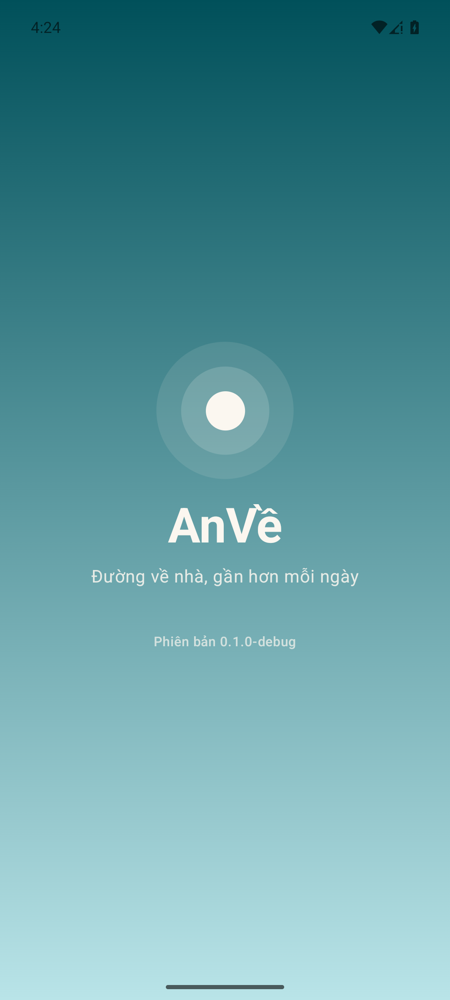
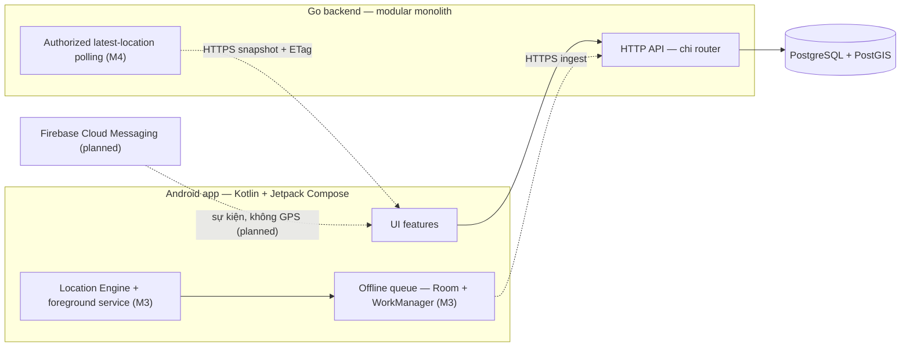

# AnVề

[](https://github.com/QuocDuong16/anve/actions/workflows/go.yml)
[](https://github.com/QuocDuong16/anve/actions/workflows/android.yml)

> **Đường về nhà, gần hơn mỗi ngày.**

**AnVề** là ứng dụng Android chia sẻ vị trí và hỗ trợ an toàn cho các thành viên
trong gia đình: mỗi người chủ động chia sẻ vị trí của mình, cả nhà biết nhau
đang ở đâu, vị trí được cập nhật lần cuối khi nào, dữ liệu đó đáng tin ở mức
nào, và có cần hỗ trợ hay không.

Điểm khác biệt cốt lõi của AnVề: ứng dụng không chỉ vẽ một marker trên bản đồ —
nó cho người xem biết **dữ liệu vị trí mới đến đâu và đáng tin ở mức nào**
(Location Confidence), trong khi quyền chia sẻ luôn nằm trong tay từng thành
viên và được backend thực thi (Privacy & Consent), với Location Engine tiết kiệm
pin và bám sát thực tế Android (Battery-Aware, Android Reliability).

AnVề **không phải spyware**: không có chế độ theo dõi bí mật, không giám sát ai
mà không có sự đồng ý của họ. Ứng dụng cũng không thay thế dịch vụ cấp cứu
chuyên nghiệp.

- **Dành cho:** gia đình nhỏ — phụ huynh dõi con đi học/về muộn, con cái dõi bố
  mẹ ở xa, các cặp vợ chồng đi làm về muộn.
- **Định vị:** *Family Safety & Location Intelligence for Android.*
- **Phạm vi ban đầu:** gia đình nhỏ; kiến trúc đủ tốt để mở rộng hoặc thương mại
  hóa trong tương lai.

## Trạng thái phát triển

Dự án đã hoàn thành **M0 (foundation)**, **M1 (authentication, thiết bị,
privacy foundation)**, **M2 (Family Circle)**, **M3 (Location Engine,
consented ingestion, offline sync)** và **M4 (authorized Live Map)** ở mức
code + automated verification:
PostgreSQL/PostGIS integration test, Android JVM test, lint/APK trong CI, cùng
smoke test HTTP trên stack thật. M3 **chưa được field-validate trên điện thoại
thật** — pin, hành vi nền, reboot và các giới hạn OEM vẫn là *Pending Field
Validation*, không phải PASS. M4 chưa được runtime/device-validate: chưa có
emulator hoặc Maps API key để xác minh map rendering. Trạng thái chi tiết từng mốc và bằng chứng xác minh ở
[`docs/product/roadmap.md`](docs/product/roadmap.md) và
[`docs/implementation/progress.md`](docs/implementation/progress.md).



## Phạm vi chức năng

Tổng quan các nhóm tính năng hướng tới. Đặc tả đầy đủ và trạng thái từng nhóm ở
[`docs/product/features.md`](docs/product/features.md).

| Nhóm chức năng | Mô tả | Trạng thái |
| --- | --- | --- |
| Nền tảng M0 | Splash screen, health/meta API, migrations, CI, toolchain | **Implemented — Verified** |
| Xác thực & phiên | Google/dev login, session opaque có rotation, thiết bị, xóa tài khoản | **Implemented — Verified** (M1) |
| Family Circle | Nhóm gia đình, invite, ủy quyền theo chủ thể dữ liệu | **Implemented — Verified** (M2) |
| Live Map | Bản đồ thành viên được cấp quyền, cập nhật qua polling có điều kiện | **Implemented — Automated Verified** (M4); Pending Runtime/Device Validation |
| Smart Tracking | Location Engine thích ứng, tiết kiệm pin, chạy nền đúng quy trình | **Implemented — Automated Verified** (M3); Pending Field Validation |
| Location Confidence | Trạng thái Fresh/Delayed/Stale/Unknown theo thời điểm ghi nhận và độ chính xác | **Implemented — Automated Verified** (M4); Pending Runtime/Device Validation |
| Location History | Hành trình theo ngày, phân biệt dữ liệu bù, retention, xóa | Planned (M5); server retention 30 ngày đã có ở M3 |
| Offline Sync | Room durable queue, batch, idempotency, preserve timestamps | **Implemented — Automated Verified** (M3); Pending Field Validation |
| Privacy Controls | Consent, bật/tắt/dừng chia sẻ, thu hồi quyền, audit | Consent + audit (M1), consent/revocation tại ingestion (M3), explicit per-viewer grants và latest-read authorization (M4) **Implemented — Automated Verified**; History thuộc M5 |
| Place Alerts | Geofence cho địa điểm quan trọng, chống nhiễu, event time | Planned (M5) |
| SOS & Emergency | Sự kiện cấp cứu, lifecycle, acknowledge qua FCM | Planned (M6) |
| Safe Journey | Hành trình chủ động về đích, cảnh báo ngừng cập nhật | Planned (M7) |
| Tracking Health | Diagnostics quyền/battery/mạng/queue | Planned (M7) |
| Notifications | FCM cho sự kiện — không dùng để truyền GPS | Planned (M6) |

Quy ước trạng thái (Implemented / Verified / Planned / Proposed / Not in scope)
định nghĩa ở [`docs/product/overview.md`](docs/product/overview.md#7-phân-loại-trạng-thái-status-taxonomy).

## Kiến trúc

Android client (Kotlin + Jetpack Compose + Maps Compose) giao tiếp qua HTTPS
với backend Go (modular monolith, chi router), dữ liệu vị trí lưu trong
PostgreSQL/PostGIS. Live Map lấy snapshot được phân quyền bằng conditional
polling; server-push và thông báo FCM vẫn planned — xem
[`docs/architecture/overview.md`](docs/architecture/overview.md) để có ranh giới
component, data flows và các quyết định kỹ thuật chưa chốt.



## Công nghệ

| Tầng | Công nghệ |
| --- | --- |
| Android | Kotlin, Jetpack Compose, Maps Compose (M4), Fused Location Provider (M3), Room (M3), WorkManager (M3), FCM*, Geofencing API* |
| Backend | Go 1.27, chi router, pgx, PostgreSQL + PostGIS (location ingestion + retention from M3) |
| Contracts | OpenAPI (`packages/api-contracts/openapi.yaml`) — đổi contract trước handler |
| Hạ tầng dev | Docker Compose (postgres/postgis + migrate + api), GitHub Actions, mise |

\* *Các dependency Android đánh dấu sao chưa được thêm vào project; chúng thuộc
các milestone M5/M6.* Maps Compose đã có trong M4, nhưng render bản đồ cần Maps
API key do nhà phát triển cấu hình theo `docs/implementation/setup-android.md`.

### Local stack & development login

`make docker-up` chỉ publish cổng API và PostgreSQL trên `127.0.0.1`; máy khác
trong LAN không truy cập được. Chạy API trực tiếp (không Docker) mặc định bind
`127.0.0.1:8080`. Development login chỉ mount khi
`ENVIRONMENT=development` và `AUTH_DEV_LOGIN_ENABLED=true`, và còn phải qua
allowlist địa chỉ nguồn; xem
[`docs/implementation/setup-android.md`](docs/implementation/setup-android.md).
`make compose-lint` (chạy trong `make quality-check` và CI) fail nếu một port
Compose bị publish ra ngoài loopback.

## Roadmap

| Milestone | Phạm vi | Trạng thái |
| --- | --- | --- |
| M0 | Foundation: toolchain, CI, migrations, local stack, splash | **Implemented — Verified** |
| M1 | Authentication, device identity, privacy foundation | **Implemented — Verified** (automated; chờ field validation) |
| M2 | Family Circle & membership authorization | **Implemented — Verified** (automated; chờ field validation) |
| M3 | Location Engine, Smart Tracking, offline queue, consented ingestion | **Implemented — Automated Verified** (runtime HTTP smoke; Pending Field Validation) |
| M4 | Live Map, authorized latest locations, confidence engine | **Implemented — Automated Verified**; Pending Runtime/Device Validation |
| M5 | Location History & Place Alerts | Planned |
| M6 | SOS, Firebase push, event acknowledgement | Planned |
| M7 | Safe Journey, diagnostics, field validation | Planned |
| M8 | Release hardening, Google Play readiness | Planned |

Chi tiết exit criteria và bằng chứng xác minh của từng mốc:
[`docs/product/roadmap.md`](docs/product/roadmap.md).

## Tài liệu

| Tài liệu | Nội dung |
| --- | --- |
| [`docs/product/overview.md`](docs/product/overview.md) | Tầm nhìn, đối tượng, điểm khác biệt, goals/non-goals |
| [`docs/product/features.md`](docs/product/features.md) | Đặc tả chức năng đầy đủ + trạng thái từng nhóm |
| [`docs/product/user-journeys.md`](docs/product/user-journeys.md) | Hành trình người dùng end-to-end |
| [`docs/product/privacy-and-safety.md`](docs/product/privacy-and-safety.md) | Consent, authorization, retention, chống lạm dụng |
| [`docs/product/roadmap.md`](docs/product/roadmap.md) | Milestones và trạng thái đã xác minh |
| [`docs/product/glossary.md`](docs/product/glossary.md) | Thuật ngữ dùng chung |
| [`docs/product/non-functional-requirements.md`](docs/product/non-functional-requirements.md) | Quality attributes, cách đo, proposed targets |
| [`docs/architecture/overview.md`](docs/architecture/overview.md) | Kiến trúc, data flows, trust boundaries |
| [`docs/adr/`](docs/adr/) | Architecture decision records |
| [`AGENTS.md`](AGENTS.md) | Quy ước làm việc cho AI coding agent |

## Setup và chạy project

### Yêu cầu

| Tool | Version | Ghi chú |
| --- | --- | --- |
| mise | ≥ 2026 | Cài mọi toolchain pin: https://mise.jdx.dev |
| Docker | ≥ 24 | Chạy PostgreSQL/PostGIS stack |
| JDK | 21 | Cài qua mise |
| Go | 1.27.3 | Cài qua mise |
| Android SDK | API 37 | Đặt `ANDROID_HOME`; không quản lý qua mise |

### Khởi động nhanh

```bash
mise install          # cài toolchain pin (mise.toml + mise.lock)
cp .env.example .env  # cấu hình local
make toolchain-check  # các pin trong repo khớp nhau
make docker-up        # PostgreSQL/PostGIS + migrate + API
```

API chạy tại <http://localhost:8080>; `GET /healthz` trả `{"status":"ok",...}`.

### Make targets thường dùng

| Việc | Lệnh |
| --- | --- |
| Full local stack | `make docker-up` / `make docker-down` |
| Chạy API local | `make server-run` (port 8080) |
| Build APK debug | `make android-build` |
| Compile release (minified) | `make android-release` |
| Kiểm tra Go | `make server-check` |
| Kiểm tra Android | `make android-check` |
| Migrations | `make migrate-up` / `make migrate-down` |
| Mọi thứ | `make quality-check` |

`make help` liệt kê đầy đủ mọi target.

### Cấu trúc repo

```
anve/
├── apps/
│   ├── android/          # Kotlin + Jetpack Compose client
│   └── server/           # Go backend
├── packages/
│   └── api-contracts/    # OpenAPI contract
├── infra/
│   ├── docker/           # Docker Compose stack
│   └── migrations/       # SQL migrations
├── docs/
│   ├── product/          # Product documentation
│   ├── architecture/     # Architecture documentation
│   ├── adr/              # Architecture decision records
│   └── screenshots/
├── scripts/              # Repository quality scripts
├── .github/workflows/    # CI
├── Makefile              # Mọi development task
└── mise.toml             # Toolchain pin
```

### Ghi chú kỹ thuật Android

Dự án dùng Android Gradle Plugin 9, vốn biên dịch Kotlin qua Kotlin support
tích hợp sẵn của AGP — plugin `org.jetbrains.kotlin.android` **cố ý không được
áp dụng**. Compose compiler plugin vẫn được áp dụng riêng vì là artifact khác
với Kotlin compiler. Gradle wrapper pin cùng phiên bản Gradle với `mise.toml`
và kiểm tra checksum của distribution trước khi chạy.

### Toolchain và dependency updates

`mise.toml` pin Go, JDK và Gradle distribution; `mise.lock` ghi artifact đã
resolve kèm checksum. Máy dev và CI runner cài đúng cùng một bộ tool;
`scripts/check_toolchain_versions.sh` (chạy qua `make toolchain-check`) làm fail
build khi một version xuất hiện ở nhiều nơi nhưng lệch nhau.

Dependabot quản lý 5 ecosystem (`gomod`, `gradle`, `github-actions`,
`docker-compose`, `docker`), group các update minor/patch; các pin mise và
Android platform levels được cập nhật tay. `scripts/check_dependabot.py` (chạy
qua `make deps-lint`) validate cấu hình với schema của Dependabot. Runtime
images được pin bằng digest; Dependabot mở PR nâng tag và digest cùng nhau.

## Testing & CI

Hai workflow độc lập chạy trên mọi pull request và push lên `main`:

- **Go** — format, tidy, vet, golangci-lint, govulncheck, test với race
  detector, build; thêm job chạy migrator integration test trên
  PostgreSQL/PostGIS thật (up → down → rollback); một job kiểm tra OpenAPI
  contract, lint workflow files và Dependabot config.
- **Android** — unit test, lint, build debug APK, compile the minified
  release build và upload debug artifact.

Lưu ý: CI PASS chứng minh build/test/lint sạch, **không** chứng minh hành vi
tính năng Android trên điện thoại thật — bằng chứng on-device được ghi nhận
riêng trong [`docs/product/roadmap.md`](docs/product/roadmap.md) khi có.

## License

Proprietary. All rights reserved.
