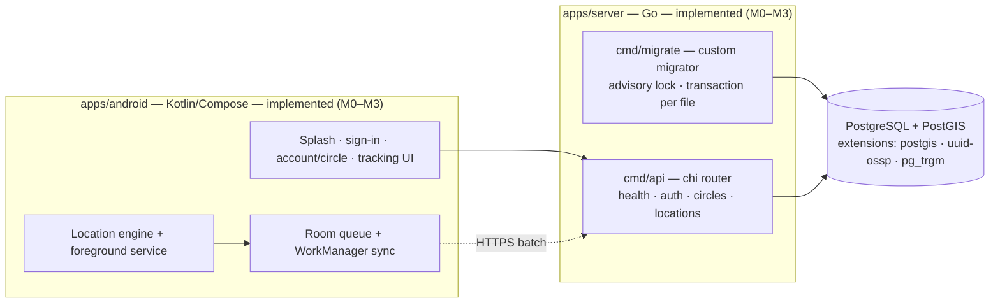
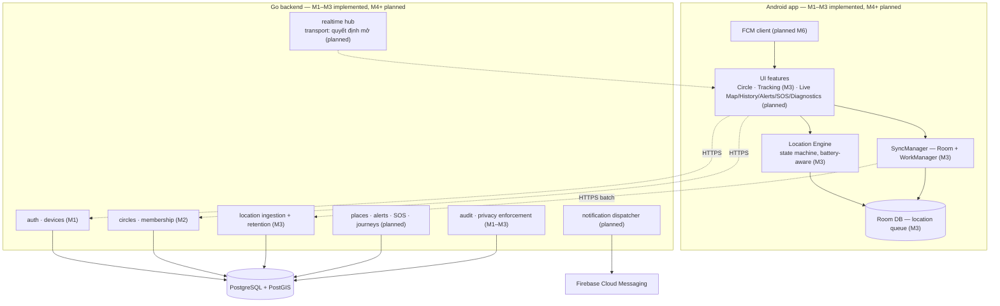
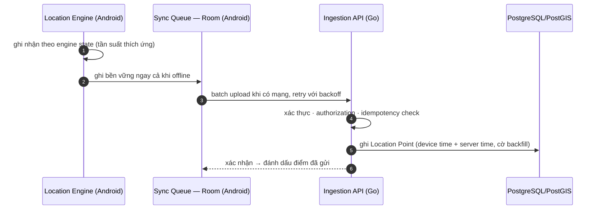
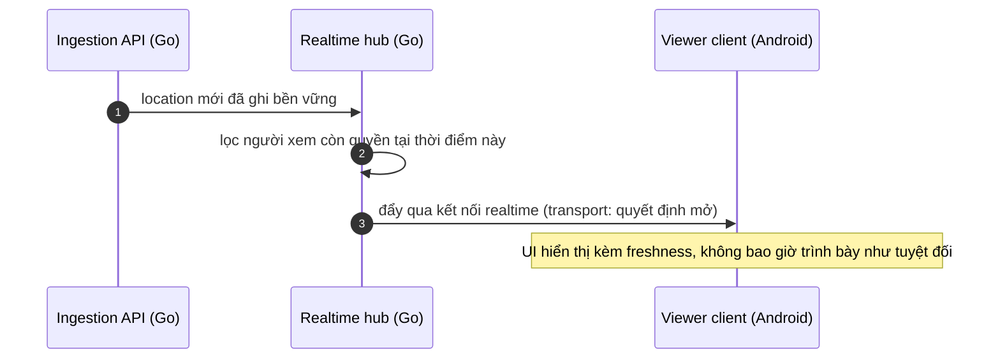
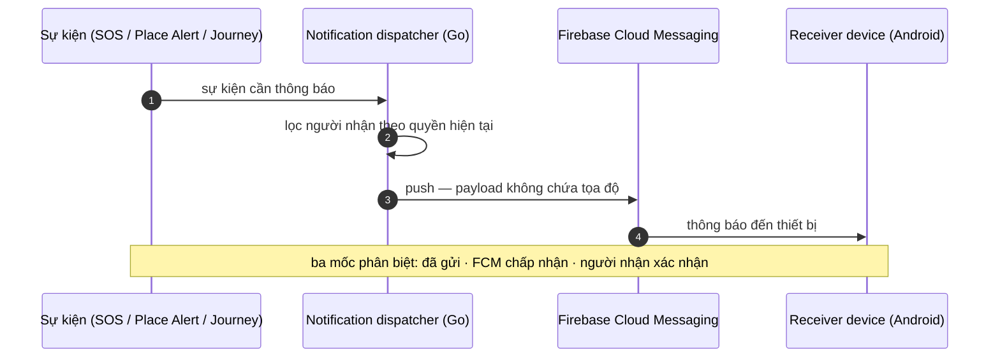

# Kiến trúc AnVề

> Tài liệu này là **source of truth** cho kiến trúc logic: ranh giới component
> Android, module Go dự kiến, các luồng dữ liệu chính, security/trust boundaries
> và các quyết định kỹ thuật chưa chốt. Toàn bộ sơ đồ phân biệt rõ phần **đã có
> trong source (M0)** và phần **định hướng (Planned)** — không có component,
> endpoint hay bảng database nào được mô tả như đã tồn tại nếu source chưa có.

## 1. Kiến trúc tổng quan

Kiến trúc hiện tại được giữ nguyên: modular monorepo theo
[ADR 0001](../adr/0001-modular-monorepo-foundation.md) (một repo, một toolchain
pin, hai ứng dụng build độc lập), backend là **modular monolith** — một binary
Go, module nội bộ có ranh giới rõ, không microservices cho đến khi quy mô buộc
phải đổi.

Kiến trúc đích khi các milestone M4–M7 hiện thực (phần M1–M3 đã có):

> Ranh giới và tên module phía trên là **định hướng** để tránh rơi vào trạng
> thái big ball of mud; đặt tên chính xác package khi hiện thực từng milestone,
> theo layout rule của [`../../AGENTS.md`](../../AGENTS.md): business logic nằm
> trong `internal/`, `cmd/` chỉ giữ entrypoint mỏng.

## 2. Ranh giới component Android

Hiện tại (M1–M3, Implemented): `MainActivity`, `ui/splash`, `ui/signin`,
`ui/home` (account, consent, devices), `ui/circle`, `ui/tracking` (tracking
status, permission flow, disclosure), `data/auth` (session storage sealed by
Keystore, SessionInterceptor, pending revocation), `data/circles`,
`data/api` (Retrofit/Moshi, ADR 0003), `data/location` (Room queue,
WorkManager sync engine), `tracking` (location provider interface, adaptive
policy, coordinator, foreground service), backup/data extraction rules
excluding `sharedpref`, `database` and `file/datastore`. Location
permissions and foreground service type `location` are declared in the
manifest; ingestion, retention and consent enforcement live in
`internal/locations` on the server.

Các ranh giới planned (thứ tự các nhóm, không phải thứ tự thư mục bắt buộc):

| Component | Trách nhiệm | Ghi chú |
| --- | --- | --- |
| **UI features** (`ui/` theo feature) | Màn hình cho từng nhóm tính năng; Composable previewable | Không chứa logic thu thập/gửi dữ liệu vị trí |
| **Location Engine** (`tracking/`) | Motion state `IDLE/STATIONARY/MOVING/JOURNEY` + operational `ACTIVE/DEGRADED/OFFLINE/PAUSED`; `LocationProvider` (Fused); foreground service type `location` | **Implemented (M3)**; quan sát được qua tab Vị trí; không viết trực tiếp vào network |
| **SyncManager** (`data/location/`) | Durable queue → batch upload → retry/backoff → idempotency | **Implemented (M3)**; WorkManager unique/network-constrained; dữ liệu không đi thẳng từ Engine ra network |
| **Room persistence** | Location Point chờ gửi, retry metadata | **Implemented (M3)**: owner-scoped, eventId PK, 5.000 điểm/7 ngày, schema export, không destructive migration; domain `database` bị backup rules loại trừ |
| **Network client** | HTTP đến Go API; kết nối realtime | Contract theo [`../../packages/api-contracts/openapi.yaml`](../../packages/api-contracts/openapi.yaml) |
| **FCM client** | Nhận push sự kiện; không nhận GPS | Xem [Push notification flow](#43-push-notification-flow-planned--m6) |

## 3. Module Go

Module nội bộ `internal/` và trạng thái hiện tại (cập nhật sau M1/M2):

| Module | Trách nhiệm | Trạng thái |
| --- | --- | --- |
| `httpapi` + `config` | Router, middleware, error envelope, cấu hình | Implemented (M0–M2) |
| `auth` | Đăng nhập, phiên, thiết bị, consent switch, xóa tài khoản | Implemented (M1) |
| `circles` | Circle, membership, invite, vai trò, giải tán | Implemented (M2) |
| `audit` | Ghi sự kiện privacy trong cùng transaction với nghiệp vụ | Implemented (M1, ownership thống nhất ở ADR 0004) |
| `testdb` | Scratch database cho integration tests | Implemented (test infrastructure) |
| `locations` | Ingestion Location Point (identity, idempotency, validation), retention purge; history query thuộc M5 | **Implemented (M3)** ingestion + retention |
| `realtime` | Hub phân phát vị trí realtime | Planned (M4) |
| `places` / `alerts` | Geofence events, verification, chống nhiễu | Planned (M5) |
| `sos` / `journeys` | Event lifecycle, acknowledge | Planned (M6, M7) |
| `notify` | Dispatcher FCM, lọc người nhận theo quyền | Planned (M6) |

Nguyên tắc giữ nguyên: contract-first (đổi OpenAPI trước handler); API server
chạy được không cần database cho đến khi tính năng đầu tiên cần; `log/slog`
JSON; version inject lúc build.

## 4. Luồng dữ liệu

### 4.1 Location ingestion + offline sync (Implemented — M3)

Bất biến của luồng này (đã automated-verified ở M3): điểm đã ghi vào Room
không bị mất chỉ vì upload thất bại; gửi lại không sinh trùng
(`(user_id, event_id)` unique + `ON CONFLICT DO NOTHING`); original
timestamps được giữ nguyên — backfill không làm sai thứ tự thời gian; tắt
chia sẻ xóa các điểm chưa gửi và gửi revocation trước mọi upload; rời
Circle/device bị thu hồi làm server từ chối và client purge queue. Chi tiết:
ADR 0006 và [`product/features.md`](../product/features.md#7-offline-sync).

### 4.2 Realtime distribution (Planned — M4)

Ràng buộc: realtime không bao giờ đi qua FCM; người mất quyền (tắt chia sẻ, rời
Circle) bị hub loại khỏi phân phát từ nguồn. Last known location là fallback
hiển thị, không phải kênh realtime.

### 4.3 Push notification flow (Planned — M6)

FCM chỉ mang **sự kiện**, không mang GPS liên tục. FCM data message có thể dùng
làm tín hiệu "có dữ liệu mới, hãy fetch" — mẫu này không vi phạm ràng buộc nhưng
là quyết định mở (xem §7).

## 5. Security boundaries

Các ranh giới tin cậy và biện pháp tương ứng:

| Ranh giới | Mức tin cậy | Biện pháp |
| --- | --- | --- |
| Android device → Go API | **Không tin cậy** — mọi request từ client đều có thể giả mạo | Authorization per-request từ backend (không dựa UI); validation; idempotency; không tin timestamp client một cách mù quáng (ghi cả hai mốc) |
| Internet → chi router | Bán tin cậy | Không dùng `middleware.RealIP` (spoofing `X-Forwarded-For` — bất biến Implemented); allowlist trusted-proxy là việc của deployment |
| Go API → PostgreSQL | Tin cậy nội bộ | Dev: postgres publish **loopback only** qua network `db-host`; production: database trên internal network, không publish port |
| Development listener → dev-login fixture | Chỉ nên là máy dev | `LISTEN_ADDR` mặc định loopback; non-loopback cần opt-in + CIDR allowlist; route tự kiểm tra `RemoteAddr`, không tin proxy header; Compose publish `127.0.0.1` và `compose-lint` chặn publish ra ngoài |
| Go API → FCM | Dịch vụ bên thứ ba | FCM chỉ nhận payload sự kiện, không chứa tọa độ; kênh một chiều từ dispatcher |
| Device storage | Tin cậy thiết bị | Backup/data-extraction rules loại trừ `sharedpref` + `database` + `file/datastore` (session, installation id, pending-revocation queue, Room location queue; Implemented). Room không được mã hóa thêm ở tầng ứng dụng trong M3: threat model/residual risk ở ADR 0006 §6. |
| Logs | — | Không log token, tọa độ nhạy cảm, credentials (quy tắc chung, cả Go và Android) |

## 6. Technical decisions đã chốt (tham chiếu)

- Modular monorepo — [ADR 0001](../adr/0001-modular-monorepo-foundation.md).
- Authentication (Google Sign-In + opaque sessions) — [ADR 0002](../adr/0002-authentication-google-signin-opaque-sessions.md).
- Android JSON (Moshi) — [ADR 0003](../adr/0003-android-json-moshi.md).
- M1/M2 hardening: xóa tài khoản không giải tán Circle có thành viên, cách ly
  identity dev/Google, audit một sự kiện một dòng trong transaction, session
  lifecycle offline, backup exclusion, installation identity, consent ≠
  tracking — [ADR 0004](../adr/0004-m1-m2-hardening.md).
- Final M1/M2 hardening: listener/allowlist cho development login, hàng đợi
  pending-revocation có giới hạn, deletion serialize với tạo Circle, thông
  báo offline sign-out ở app scope — [ADR 0005](../adr/0005-network-boundary-and-offline-revocation.md).
- M3 Location Engine: atomic idempotent ingestion, consent/Circle/device
  authorization trong transaction, retention 30 ngày, adaptive policy,
  foreground-service lifecycle, Room/WorkManager offline delivery, privacy-first
  consent revocation — [ADR 0006](../adr/0006-m3-location-engine.md).
- Custom migrator (không golang-migrate), advisory lock, transaction per file,
  bookkeeping table `schema_migrations` do migrator sở hữu — Implemented, có
  integration test trong CI.
- Runtime images pin bằng digest; Dependabot nâng tag + digest cùng nhau.
- Toolchain pin qua `mise.toml`/`mise.lock` với drift check.

## 7. Các quyết định kỹ thuật chưa chốt

Những quyết định này **cần được chốt trước khi hiện thực milestone tương ứng**
và nên có ADR riêng khi quyết:

1. **Realtime transport** — WebSocket là định hướng; cân nhắc SSE/polling trước
   khi chốt (chi phí vận hành, reconnect, môi trường mạng của người dùng Việt Nam).
2. ~~**Phương thức authentication**~~ — đã chốt: Google Sign-In + opaque
   session ([ADR 0002](../adr/0002-authentication-google-signin-opaque-sessions.md)).
3. **FCM data message làm tín hiệu fetch** — dùng hay không, và cơ chế debounce.
4. ~~**Idempotency key của Location Point**~~ — đã chốt `(user_id, event_id)`
   với client UUID, server trả `duplicates`; ADR 0006 §1.
5. **Retention mặc định** — M3 đặt tạm 30 ngày (`LOCATION_RETENTION_DAYS`);
   con số cho history UI (M5) và event data vẫn mở.
6. **Confidence calibration** — phương pháp nếu tiến tới confidence score.
7. **Production deployment** — target (VPS, cloud, managed Postgres…) chưa quyết;
   ảnh hưởng observability và SLO đo được.
8. **Một-Circle trong MVP** — xác nhận giữ một-Circle hay nới sớm; ảnh hưởng
   schema membership và UX switcher. M3 hiện yêu cầu đúng một Circle active.
9. **Rate limiting SOS/invite** — ngưỡng và cơ chế chống lạm dụng.
10. ~~**Chính sách backup từng file Room**~~ — đã chốt: toàn bộ domain
    `database` bị loại khỏi backup/transfer; Room không mã hóa thêm ở M3 với
    threat model ghi ở ADR 0006 §6.
11. ~~**Pending-revocation retry ngoài app start**~~ — đã chốt: WorkManager
    unique + network constraint (ADR 0006 §7 dùng cùng mô hình cho location
    sync).
12. **Mã hóa Room khi có History/M5** — SQLCipher hoặc payload seal; tiêu chí
    đã ghi trong ADR 0006 §6.

Mỗi quyết định khi chốt cần ADR mới trong [`../adr/`](../adr/) và cập nhật tài
liệu liên quan ở `docs/product/`.
